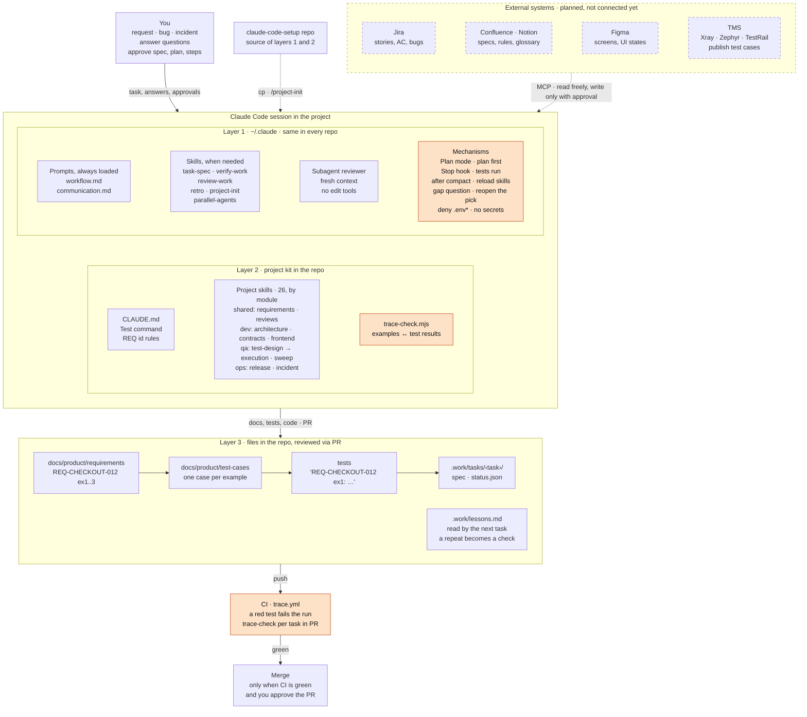

# Claude Code working setup

*Instructions for judgment; mechanisms for enforcement.*

How Claude works (workflow), how it writes (communication), six global
on-demand skills, a layer-2 kit of 26 project skills in four modules, the
mechanisms that enforce what must not be skipped, and where work is recorded
so it can be resumed and learned from.

Start with `architecture/overview.html` (in Vietnamese; open it in a
browser after cloning): the whole design, from the three layers down to each
file, with examples.

```
~/.claude/                          LAYER 1 · global, every task
├─ CLAUDE.md                        imports the two prompts below
├─ prompts/
│  ├─ workflow.md                   always loaded: rules, framing, gates, task files
│  ├─ communication.md              always loaded: writing, message and file shapes
│  ├─ places.md                     always loaded: default path of each file kept
│  └─ message-shapes.md             read on demand: the T1+ report shape, diagrams
├─ skills/
│  ├─ task-spec/SKILL.md            contract for a task that outlives a session
│  ├─ verify-work/SKILL.md          prove a delivery is done
│  ├─ review-work/SKILL.md          any review, in a fresh context
│  ├─ retro/SKILL.md                surprises → lessons → checks
│  ├─ project-init/SKILL.md         detect, then install layer 2 into a repo
│  └─ parallel-agents/SKILL.md      fan out agents for work too big for one
├─ project-kit/                     layer 2 source that project-init copies from
├─ agents/reviewer.md               independent reviewer, no edit tools
├─ agents/Explore.md                replaces the built-in search agent, on Haiku
├─ hooks/require_tests.py           Stop hook: tests must run after code edits
├─ hooks/after_compact.py           after a compaction: reload skills, keep the language
├─ hooks/gap_question.py            on a "là gì / why" message: explain another way, reopen the pick
├─ hooks/measure_session.py         Stop hook: session metrics (runs measurement/crawl.py)
├─ settings.json                    + the hook entries, .env deny rules,
│                                   attribution off
└─ lessons.md                       lessons about how Claude works (grows by use)

<project>/                          LAYER 2 · per repo, from project-kit/
├─ CLAUDE.md                        Test command · REQ ids · where things live
├─ .claude/skills/                  26 skills in modules shared · dev · qa · ops;
│                                   project-init installs only the ones chosen
│                                   (requirements, test-design, bug-report, backend,
│                                   release, qa-sweep, …), frontend split web/mobile
├─ scripts/trace-check.mjs          examples ↔ test results → status.json
└─ .github/workflows/trace.yml      CI: tasks in a PR must be proven
                                    LAYER 3 · artifacts in the same repo
├─ docs/product/                    the system as it is: requirements, test-cases,
│                                   architecture, decisions
└─ .work/                           the work: tasks/<date>-<name>/{spec,status},
                                    test-plans, test-runs, releases, incidents, lessons.md
```

Layer 1 works alone. Add layer 2 to a project with the `project-init` skill,
or by hand with `project-kit/README.md`.

## How it works in a project

Highlighted nodes are mechanisms: a machine blocks there, whatever Claude
remembers. The rest are instructions, which Claude follows by judgment.
Dashed boxes are planned and not built yet: see [Not built yet](#not-built-yet).



## Install

Needs Claude Code, Python 3 and Node.js (tested with Python 3.13 and Node 22).

```bash
git clone https://github.com/tandt53/claude-code-setup.git
cd claude-code-setup
mkdir -p ~/.claude/prompts ~/.claude/skills ~/.claude/agents ~/.claude/hooks ~/.claude/measurement
cp prompts/*.md ~/.claude/prompts/
cp -r skills/* ~/.claude/skills/
cp agents/*.md ~/.claude/agents/
cp hooks/require_tests.py hooks/after_compact.py hooks/gap_question.py hooks/measure_session.py ~/.claude/hooks/
cp measurement/crawl.py ~/.claude/measurement/
cp -r project-kit ~/.claude/
touch ~/.claude/lessons.md
```

1. **`~/.claude/CLAUDE.md`** imports the prompts:
   ```markdown
   # Global Claude Code Config

   @~/.claude/prompts/workflow.md
   @~/.claude/prompts/communication.md
   @~/.claude/prompts/places.md
   ```
2. **`~/.claude/settings.json`**: merge in `settings.snippet.json`, keeping
   any hooks and permission rules you already have.
3. **Each project**: its CLAUDE.md (or AGENTS.md) gets these lines. Claude
   adds them when it creates or updates the file.
   ```markdown
   Test command: `npm test`
   Product docs: `docs/product/` (requirements, decisions, architecture)
   Work records: `.work/` (tasks, test-plans, incidents, lessons.md).
   Read `.work/` files by path; search may skip hidden folders.
   ```
   and `.gitignore` gets `.work/tasks/*/status.json`. The rest of `.work/`
   is committed: it is the record reviews and retros read. For the full SDLC
   / STLC layer, install `project-kit/` instead: its CLAUDE.md block
   includes these lines.

   These lines are where a project names its folders. Change the paths to
   put the work, the lessons or the decision records elsewhere: the global
   files and skills follow CLAUDE.md, and their paths are only defaults.
   With `project-kit/`, keep `.work/`: `trace.yml` reads `.work/tasks/`.

### Upgrading from an earlier copy

- If you saved skills from claude.ai review cards, keep one copy of each in
  Claude Code.
- Remove any old `spec`, `verify` or `review` skills: they are now
  `task-spec`, `verify-work`, `review-work`. Remove
  `~/.claude/skills/mutation-check` too: its procedure now lives in the verify
  skill (Check the checks) and the workflow's Do step.
- Remove any output style from earlier setups (Task Reporting, Communication)
  so the rules are not loaded twice.

## Check it works

- `/memory` lists the three prompt files. `/hooks` lists two Stop hooks
  (tests ran; session metrics), the SessionStart hook and the
  UserPromptSubmit hook. Every file a hook command names must exist: a
  missing script exits 2, which a Stop hook reads as "do not stop".
  `/agents` lists `reviewer` and `Explore` (yours, on Haiku). `/permissions` lists the three `.env` rules.
- Run the live tests in `docs/MECHANISMS.md`: one that must block and one
  that must not, for each mechanism.
- `python3 -m unittest discover -s hooks` runs the hooks' 66 tests.
- `python3 docs/trace.py` confirms every idea of the design still has a home,
  that no path is written outside `prompts/places.md` and no skill name
  outside its own skill, and that every cross-reference names a section
  that exists.
- `node --test project-kit/tests/trace-check.test.mjs project-kit/tests/mobile-run.test.mjs project-kit/tests/browser-run.test.mjs`
  runs trace-check's 28 tests, mobile-run's 18 and browser-run's 10.

## Files here

| Path | What |
|---|---|
| `architecture/overview.html` | the whole design: layers, 8 steps, 4 gates, task files and where they live, learning loop, mechanisms with what was tested, examples, status |
| `architecture/three-layers.html` | SDLC and STLC matrices across the three layers |
| `prompts/` | workflow.md, communication.md, places.md, message-shapes.md (read on demand, not imported) |
| `skills/` | task-spec, verify-work, review-work, retro, project-init, parallel-agents |
| `agents/reviewer.md` | reviewer subagent |
| `agents/Explore.md` | search subagent on Haiku, overriding the built-in one |
| `hooks/` | Stop hooks (tests ran, session metrics), SessionStart hook for compaction, UserPromptSubmit hook for gap questions, and their tests |
| `settings.snippet.json` | the hook entries, `.env` deny rules and attribution off, for settings.json |
| `docs/MECHANISMS.md` | per mechanism: what it enforces, what it does not, tests |
| `docs/TRACEABILITY.md` | where each idea now lives |
| `docs/trace.py` | re-runs that audit; fails if an idea goes missing |
| `docs/skill-authoring.md` | the standard every skill is written and reviewed against: evaluate first, workflow with a checklist, only what the model lacks |
| `docs/measurement-strategy.md`, `docs/rule-ledger.md` | how the setup is measured, the results, and the evidence for each always-loaded rule |
| `measurement/` | the A/B harness (`ab_multi.py`) and its scenarios; `crawl.py`, which the session-metrics Stop hook runs |
| `project-kit/` | layer 2 for a TypeScript/JS or Python repo: 26 skills in 4 modules (shared · dev · qa · ops), `modules.json`, templates, trace-check, CI |
| `archive/workflow-v1-long.md` | the original 214-line workflow |

## When something goes wrong

- Claude ignores a rule: the always-loaded files may be too long, or the rule
  ambiguous. Prune before adding.
- The same mistake twice: run `retro`. It turns the repeat into a check (test,
  lint, hook) before a line of prose, and shows the check failing first.
- After editing any file here, run `python3 docs/trace.py`.

## Not built yet

Each item names what exists today, so the gap is clear.

- **Reading Jira, Confluence, Notion and Figma.** Claude Code can use any MCP
  server a project connects, and the `requirements` skill already takes a
  ticket as input. The kit has no `.mcp.json` template, and no one has tried
  it with the kit.
- **Writing to those systems** (a bug from `bug-report`, a comment): no
  `ask` permission rules for write tools yet, and no tests for them in
  `docs/MECHANISMS.md`.
- **TMS** (Xray, Zephyr, TestRail…): test cases live in Git, in
  `docs/product/test-cases/`. Publishing them to a TMS first needs a choice of
  which one is the source of truth.
- **Versioned distribution.** Layers 1 and 2 are copied, so a fix reaches no
  machine or repository that installed an earlier copy. A plugin marketplace
  and an npm package for `trace-check` would fix that.
- **Stacks and hosts beyond TypeScript/JavaScript on GitHub.** `project-init`
  stops without a `package.json`, and `trace.yml` is GitHub Actions only.
- **A real task through all three layers**, including `trace.yml` running on
  GitHub: one pull request that must be blocked, one that must pass.

## License

Apache License 2.0: see `LICENSE`.
